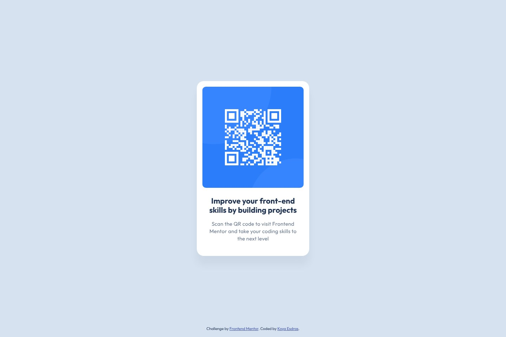

# Frontend Mentor - QR code component solution

This is a solution to the [QR code component challenge on Frontend Mentor](https://www.frontendmentor.io/challenges/qr-code-component-iux_sIO_H). Frontend Mentor challenges help you improve your coding skills by building realistic projects.

## Table of contents

- [Overview](#overview)
  - [Screenshot](#screenshot)
  - [Links](#links)
- [My process](#my-process)
  - [Built with](#built-with)
  - [Workflow](#workflow)
  - [What I learned](#what-i-learned)
  - [Continued development](#continued-development)
  - [Useful resources](#useful-resources)
  - [AI Collaboration](#ai-collaboration)
- [Author](#author)

## Overview

### Screenshot



### Links

- Solution URL: [frontendmentor.io/solutions/qr-code-component-EZNAAGXXm_](https://www.frontendmentor.io/solutions/qr-code-component-EZNAAGXXm_)
- Live Site URL: [ounokoya.github.io/front-ui-qrcode](https://ounokoya.github.io/front-ui-qrcode/)

## My process

### Built with

- Semantic HTML5: an `article` in `main`, the title as the page's `h1`, the QR code as an `img` whose text alternative says where it leads
- [Tailwind CSS v4](https://tailwindcss.com/) — design tokens in `@theme`, default palette removed, a named `link` utility for the attribution
- Outfit served with the site through [Fontsource](https://fontsource.org/)
- One layout for every width: the 320 × 498 card centred in the window, shrinking with 16 px margins below 352 px
- [Vite](https://vite.dev/) for the build, deployed on GitHub Pages from the `gh-pages` branch (`npm run deploy`)
- [Playwright](https://playwright.dev/), [axe-core](https://github.com/dequelabs/axe-core), the W3C Nu validator, html-validate and ESLint for tests

### Workflow

This is version 2 of my 2023 solution, rebuilt from the current starter in the same repository. Before any code, the design was analysed and rebuilt:

1. **Visual analysis in Excalidraw** — measurements in px, contrast checks, the HTML tree → [`specs/visuel/`](./specs/visuel/)
2. **Penpot mockup** — library, desktop, mobile and tablet screens, visual thresholds calibrated against the design JPGs → [`specs/visuel/penpot/`](./specs/visuel/penpot/)
3. **Spec, then tests** — 17 Given/When/Then scenarios and the accessible names the tests rely on → [`specs/specifications/`](./specs/specifications/); the tests were written before the code and checked to fail on the starter
4. **Decisions** — tokens, fonts, a static page with one image at twice its size, the centred card → [`specs/adr/`](./specs/adr/)
5. **Code**, then a walk-through in a real browser → [`specs/analyse/`](./specs/analyse/)

### What I learned

**Centring a card without letting the footer push it.** Three grid rows, the card in the middle one, the attribution at the bottom of the last one: the two `1fr` rows share the free space equally, so the card stays in the exact centre of the window.

```html
<body class="grid min-h-dvh grid-rows-[1fr_auto_1fr]">
  <main class="row-start-2">…</main>
  <footer class="row-start-3 self-end">…</footer>
</body>
```

**A card that shrinks only when it must.** `width: min(20rem, 100% - 2rem)` keeps 320 px on every screen and 16 px margins on the smallest ones, without a breakpoint.

**Measuring letter spacing.** The three lines of the sentence are 3 % wider in the design than with the default spacing; 0.2 px of letter spacing gives the same line breaks and widths.

### Continued development

- **Visual comparison with the design files.** Screenshots differ from the Frontend Mentor JPGs by 0.63 % (desktop) and 3.65 % (mobile) of pixels, for a 5 % threshold.
- **Tablet**: my own proposal, the same card centred.

### Useful resources

- [MDN — `min()`](https://developer.mozilla.org/en-US/docs/Web/CSS/min) — a width with a maximum and a margin in one value.
- [W3C WAI — Informative images](https://www.w3.org/WAI/tutorials/images/informative/) — what the text alternative of the QR code should say.

### AI Collaboration

I used **Claude (Claude Code)** as a pair, inside my own spec-driven workflow where I validated each step before the next one:

- **Planning**: Claude listed my old solutions that needed a rebuild and wrote the plan, which I validated.
- **Design analysis and mockup**: Claude measured the JPG designs, drew the annotated Excalidraw analysis and built the Penpot mockup; I reviewed both and decided on the text alternative of the QR code, the heading level and the tablet layout.
- **Spec and tests**: written by Claude before any code, from the validated mockup.
- **Technical decisions**: fonts from Fontsource, as in my earlier solutions without font files in the starter.
- **Code**: written by Claude from the spec — I confirmed this split at the code lock — with the tests run at each step.

What worked well: comparing the page with the design pixel by pixel explained every difference before it was fixed. What needed my decisions: the choices listed above.

## Author

- Frontend Mentor - [@ounokoya](https://www.frontendmentor.io/profile/ounokoya)
- GitHub - [@ounokoya](https://github.com/ounokoya)
